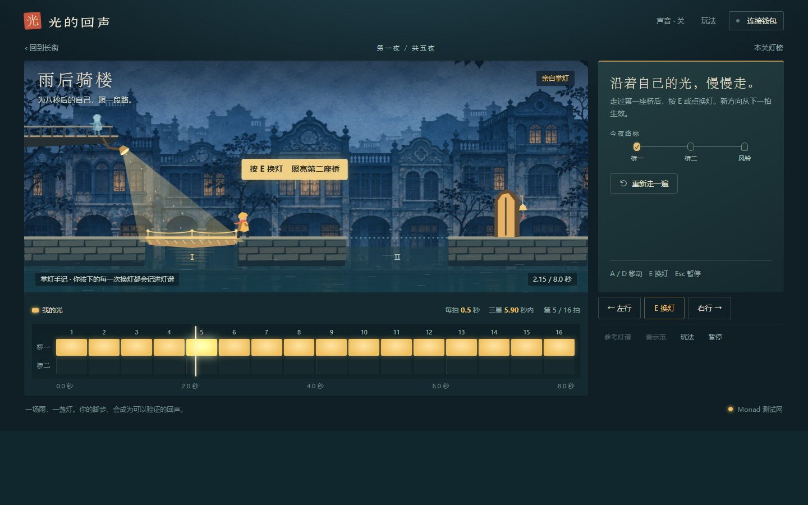
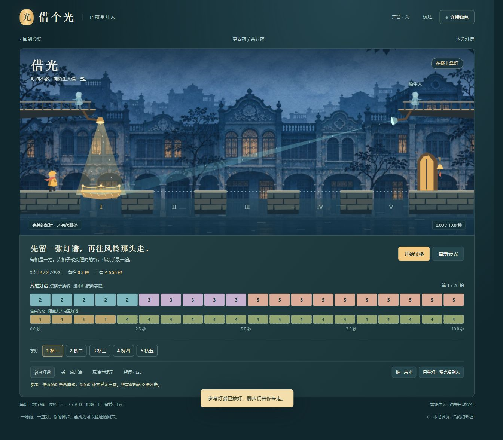

# 光的回声 · 雨夜掌灯人

你在骑楼上，为未来的自己掌灯。再到楼下，沿着灯光过河。到了第四夜，必须借一束陌生人的光。

Monad Blitz@广州参赛项目。五关玩法、参考走法、确定性模拟、Solidity 验证合约与钱包接入已完成。**合约已部署到 Monad 测试网**，五关规则与三份借光种子已初始化。

合约：[`0xfc1d55e57774bec10dd4dd4a13798d66e98be7a1`](https://testnet.monadvision.com/address/0xfc1d55e57774bec10dd4dd4a13798d66e98be7a1)。MonadVision 与 Monadscan 源码验证均通过。所有参考解通过已部署合约的只读模拟；浏览器钱包签名与实际成绩提交尚待验收。

[直接试玩《光的回声》](https://everyeveryv.github.io/borrow-light/) · 推荐电脑键盘，无需钱包。




## 开始游玩

Windows 双击项目内的 **`启动游戏.cmd`**，会启动本地服务并打开浏览器。游玩期间保持启动窗口开启。

也可以在本目录运行：

```powershell
npm install --cache .npm-cache --offline=false
npm run dev
```

打开终端显示的 `http://127.0.0.1:5173/`。需要 Node.js 20.18 或更新版本。依赖和可配置 npm 缓存位于项目目录，当前目录在 D 盘。

早期单文件版本保存在 `prototype.html` 和根目录的 `index.html`。**新版入口为 `app/index.html`，通过 Vite 启动，不能直接双击新版 HTML 运行。**

## 怎么玩

- **选关：** 默认依次解锁；「自由练习」可以直接试走任一关，不伪造通关成绩。
- **掌灯：** 灯谱每行代表一座桥，每列代表一拍。点击格子可把这拍起的一段连续灯光改照该桥。也可用「重新录光」实时录制，数字键或点画面上的桥切换方向。
- **第一夜亲自掌灯（桌面）：** 按住 `D` 或 `→` 过第一座桥，在街心石台按 `E`，下一拍桥二亮起。也可以选「按灯谱走」，照自己的编排过桥。
- **过桥：** 点「开始过桥」，按住 `→ / D` 向右、`← / A` 向左。**踏出第一步才开始计时**；松开方向键可等待。
- **拾取：** 靠近纸船或灯笼按 `E`。拾取时不能移动，但潮水仍会上涨。第五关必须带灯笼。
- **复盘：** 落水后显示拍数、帧数和原因；「回看脚步」使用原始按键重放。
- **辅助：** 「参考灯谱」只填入灯光，脚步由你控制；「看一遍走法」演示完整参考解，不记成绩，也不允许上链。
- **暂停：** `Esc` 或暂停按钮；窗口失焦、页面切到后台会自动暂停。
- **手机：** 提供长按左右行走与拾取按钮。声音默认关闭，可随时开启。

个人最佳、灯谱和最近一次通关保存在本浏览器。地图的「上次通关」可以在刷新后恢复最近的成绩，供稍后上链。

| 关卡 | 机关 | 已验证参考解 |
|---|---|---:|
| 雨后骑楼 | 两座纸桥、可选纸船 | 117 帧 / 5.85 秒 |
| 三拱桥 | 三座桥、两次换灯 | 122 帧 / 6.10 秒 |
| 潮汐渡口 | 在石台等待退潮 | 182 帧 / 9.10 秒 |
| 借光 | 五座桥、两条灯轨、三束内置光 | 130 帧 / 6.50 秒 |
| 夜市长街 | 0.4 秒一拍、周期潮水、必取灯笼 | 181 帧 / 9.05 秒 |

第 5 关原 PRD 的三星线 180 帧不可达，已调整为 **181 帧**。拾取有启动帧，再经过 `itemTicks` 帧才完成；机关规则和桥端点保持 PRD 设定。

## 为什么使用 Monad

一次通关提交的内容是灯谱与每帧按键，而非玩家自报的时间。合约用同一套 20 Hz 整数规则重放整局：移动、拾取、危险判定、自动风铃，逐帧验证成功后才保存成绩。

第四关的灯谱池支持异步合作。玩家借一束已发布的光通关时，被借灯谱的次数和作者的借出光次数增加，自己的灯谱也进入公共池。离线使用三束内置种子，部署脚本会把同样的种子写入合约。

前端每次写链前执行本地重放及 `simulateContract`，并设置 `gasLimit = ceil(estimateGas × 1.1)`。确认耗时从拿到交易哈希起算，收到成功回执才显示区块号和浏览器链接。部署后仍需在真实 Monad 测试网上测量费用与延迟，不保证固定 0.8 秒。

每个玩家的最佳成绩按地址独立存储；灯谱池、分数编号与排行榜是共享写入点。这是黑客松规模下的简化设计，未宣称所有提交都完全并行。排行榜每个地址仅占一位，成绩相同按先提交者优先。

这是公开规则的解谜游戏：合约验证输入是否有效，不识别玩家是不是借助求解器，也不提供防机器人保证。

## 验证结果

```powershell
npm run vectors          # 重建并校验参考解和共享用例
npm test                 # 前端模拟 + 本地 Hardhat 合约验证
npm run build            # 类型检查 + 正式构建
```

- 36 个前端模拟测试通过。
- 25 组共享向量在前端与合约中结果一致，包括每关成功、落水、超时、潮汐、全部三束种子、最后一帧抵达、未拾灯笼和严格安全边界。
- 合约测试报告 62 项验证，覆盖篡改灯谱/按键、错误借光、排行榜去重与同分顺序、最佳成绩、所有权和临时钱包授权同意。
- 浏览器检查：1280 × 900 桌面布局、390 × 844 手机布局；实际键盘完成第一、第二、第四关；手机长按完成第一关；第三关观察潮汐落水与输入回放；第五关演示在 181 帧拾灯通关。录制、暂停、刷新恢复等检查见 `docs/QA.md`。

### 本地 gas 记录

下表是 **Hardhat / Ethereum Cancun 费用表** 的实际交易回执，**不是 Monad 测试网实测**。费用会随已有排行榜和个人最佳记录变化。完整结果在 `contracts/gas-report.json`。

| 首条参考通关 | 本地 gasUsed |
|---|---:|
| 第 1 关 | 264,361 |
| 第 2 关 | 291,660 |
| 第 3 关 | 341,538 |
| 第 4 关 | 391,422 |
| 第 5 关 | 411,151 |

第 5 关当前略高于 PRD 的 400k 目标。Monad 存储与账户访问计费不同，待钱包就绪后必须重新估算、提交并记录实际费用。合约已把每拍不变的灯光/潮汐安全状态移到拍级计算，脚步与危险检查仍逐帧执行。

## 测试网部署

当前配置：`app/src/chain/deployment.json`，`chainId: 10143`，已完成部署与初始化。部署区块 `81510552`；详情见 `docs/DEPLOYMENT.md`。

准备一个有测试 MON 的测试专用钱包，在本地把 `.env.example` 复制为 `.env`，填入 `DEPLOYER_PRIVATE_KEY`。不要把私钥发到聊天或提交到仓库。

```powershell
npm run deploy:contract
node contracts/scripts/verify.mjs
npm run build
```

部署脚本会核对网络为 Monad 测试网，部署合约，写入五关配置和 S1–S3 种子，并保存真实合约地址。流程可恢复；已部署字节码、所有者与关卡配置不匹配时会停止。关卡初始化后不可更改，因此改规则需要部署新合约。自定义 RPC 地址仅供脚本使用，不会把其中可能含有的凭据写进前端配置。

前端钱包入口支持注入式钱包、测试网切换/添加、链上最佳合并、灯谱池读取、前十名灯榜和通关提交。链上不可用时仍可离线游玩；通关记录保留，可稍后重试。内置借光在提交时按灯谱内容寻找对应的已部署种子，找不到则明确要求重新选取链上灯谱。

仍需完成：浏览器钱包签名与拒签测试、实际通关提交的 gas 和确认耗时记录、两个浏览器互借灯谱验收。之后再生成公开演示链接并提交 MOJO。

## 当前边界

- 已实现 P0 的本地玩法与合约逻辑，并完成真实测试网部署。网页可通过仓库中的 GitHub Pages 工作流发布。
- P1 已实现借光作者幽灵、直接发布灯谱入口和合约接口。**免签灯童前端、实时链上动态条尚未启用。**
- 合约预留了灯童授权与打赏接口，但当前没有对应前端开关。灯童需要主钱包提出授权后，再由灯童调用 `acceptOperator` 同意，避免陌生人直接劫持地址归属。
- GitHub Pages 发布与 MOJO 参赛提交是独立流程。
- 本地试玩成绩不是链上证明；页面清楚区分本地和已上链状态。

## 工程结构

```text
app/src/game/       整数模拟、画布渲染、音效
app/src/chain/      ABI、部署配置、钱包与合约客户端
app/src/ui/         本地存档
app/src/main.ts     页面流程、输入采样、灯谱与弹窗
app/public/assets/  从原型提取的背景图片
shared/            唯一关卡数据、共享测试向量、种子与参考解
contracts/         Solidity、编译/测试/部署/验证脚本
tests/             前端模拟测试
docs/screenshots/  实际浏览器截图
prototype.html     原始原型完整备份
```

采用 Vite + TypeScript + Canvas + viem；合约使用 Solidity 0.8.28、Cancun、OpenZeppelin Ownable/ReentrancyGuard，本地 Hardhat 验证。没有后端、代币或 NFT。




